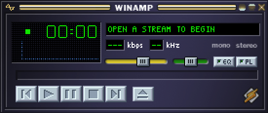
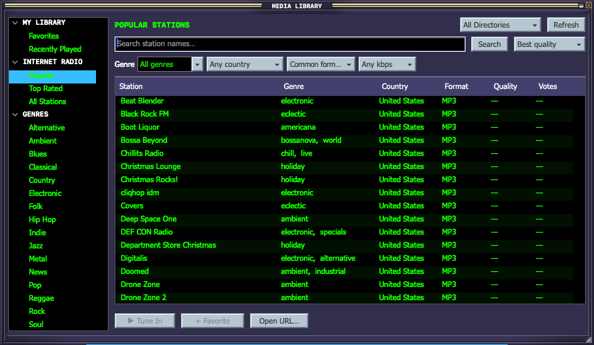
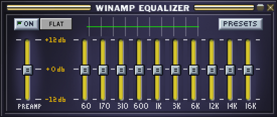
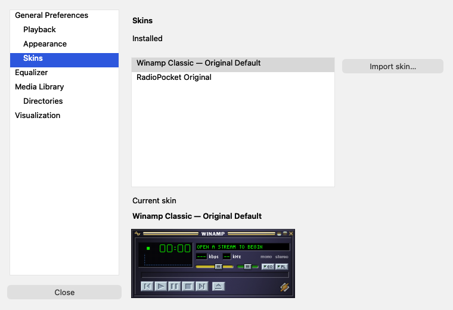

# RadioPocket

A small, native macOS internet-radio player inspired by classic desktop media players such as Winamp. RadioPocket is an independent project and is not affiliated with, owned by, or endorsed by Winamp or Nullsoft.

Swift + AppKit + AudioToolbox/AVFoundation with a small C DSP core. No package dependencies, browser runtime, account, app backend, or bundled station database. About 3.2 MB on disk.



## Features

- Direct internet radio streams, station discovery, favorites, and recent history.
- Eight built-in directories (Radio Browser, SomaFM, laut.fm, Radio Paradise, Curated Internet Radio Streams, IPRD, Junguler Radio Playlists, rrradio) plus custom M3U/PLS lists and Radio Browser–compatible servers.
- Pause, rewind and jump to live through a five-minute time-shift buffer.
- Ten-band equalizer, preamp, 18 classic presets, and `.eqf` import/export.
- Spectrum analyzer, oscilloscope and 14 full-screen visualizations.
- RadioPocket's own theme, plus import for classic `.wsz` skins.
- Internet TV: play several channels at once, each in its own video panel with its own player. Audio follows one panel at a time (click a panel's speaker icon), and Video Multiview shows every open channel in a full-screen wall. Right-click a channel and choose Tune In on a panel or a new one.
- Discover: on-device recommendations from your favorites and history.
- Sleep timer, loudness leveling, station info, and jump-to-station.
- Open streams from websites through playlist files and `radiopocket://` links.



## Quick start

Requires **macOS 13 or later** on **Apple Silicon**.

```sh
git clone https://github.com/darin2036/radiopocket.git && cd radiopocket
xcode-select --install   # once, if you have no Swift toolchain yet
./build.sh
open dist/RadioPocket.app
```

`./build.sh` checks your toolchain and reports anything missing. Full Xcode is optional: with it, the build includes the on-device AI for Discover and Moods; with only the command-line tools those features use non-AI fallbacks. The app is ad-hoc signed, not notarized, and the script also writes `dist/RadioPocket-<version>.zip`. If macOS blocks a downloaded copy, open System Settings ▸ Privacy & Security and click **Open Anyway**, or run `xattr -cr RadioPocket.app`.

## Using the player

- **LIB / ⌘B** opens the station library. **⌘O** (or **+**) enters a direct stream URL. A broadcaster's homepage is usually not its audio stream.
- **+ FAV / ⌘D** saves the current station; **⌘L** opens favorites. **⌘J** or **J** jumps to a station by name.
- **Space** plays/pauses, **↑ / ↓** change volume, **← / →** seek 10 seconds, **L** returns to live. Z X C V B are previous, play, pause, stop and next.
- **EQ / ⌘E** opens the equalizer, **SK / ⌘K** skins, **⌘,** Preferences, **⌘T** always-on-top, **⌘1/2/3** scale.
- **I** shows live stream info; **Look Up Details** contacts Radio Browser only when pressed.
- Windows snap to screen edges and to each other. Hold **Option** while dragging to move freely.

All settings live in Preferences; menus hold actions and windows.

## Station library and Discover

The library opens on **Discover**; choose **Station browser** for the table view. Browse Popular, Top Rated, All Stations or the genre tree. Search by name, filter by country, format or bitrate, and sort by column. Favorites and Recently Played (the last 30 stations that actually played) are stored locally.

Radio Browser, SomaFM, laut.fm, Radio Paradise and Curated Internet Radio Streams are on by default. IPRD, Junguler and rrradio are off until enabled because their catalogs are larger. See [directory sources and limits](Resources/DIRECTORY-SOURCES.md) for endpoints and attribution. No API key or account is needed.

Lists you open are cached on disk (`~/Library/Caches/RadioPocket/Stations`, capped at 16 MB) and refreshed quietly in the background, pausing on Low Power Mode, hot Macs and metered networks. Typed searches are never saved. Turn the cache off in Preferences ▸ Internet Radio. There is no app analytics service, and Radio Browser click reporting is off by default.

**Discover** recommends stations rated four stars or higher (estimated from codec and bitrate) using your favorites, history and chosen genres and languages. Ratings, thumbs up/down and history stay on this device. Optional on-device AI (Apple Intelligence devices only) only interprets search text; it cannot browse, install sources or start playback. Availability checks contact stations directly and can be disabled under **Your mix ▸ Listening & privacy**. Discover excludes adult and unclassified content on a best-effort basis.

More detail: [specification](docs/Discovery-Engine-Product-Spec.md) · [implementation status](docs/Discovery-Implementation.md).

## Opening radio links from websites

Move `RadioPocket.app` into Applications and open it once so macOS registers its links and playlist types.

- **Playlists:** use Finder's **Open With ▸ RadioPocket** for `.pls`, `.m3u` and `.m3u8` files, or **Get Info ▸ Open with ▸ Change All**. RadioPocket registers as an alternate handler and does not change your defaults.
- **Links:** `radiopocket://play?url=ENCODED_HTTP_URL&name=ENCODED_NAME`. **Radio ▸ Copy Open-in-Player Link** builds one for the current station.
- RadioPocket does not claim `http` or `https`, so ordinary audio links still play in the browser.

```html
<a href="radiopocket://play?url=https%3A%2F%2Fradio.example%2Flive&amp;name=My%20Radio">Open in RadioPocket</a>
```

Local playlists are limited to 256 KB and open the first HTTP/HTTPS entry. Opened links are not added to Favorites.

## Equalizer

Ten bands (60, 170, 310, 600 Hz; 1, 3, 6, 12, 14, 16 kHz) at ±12 dB plus a preamp. Double-click or Option-click a slider to reset it; arrow keys adjust in 0.5 dB steps. Custom presets, `.eqf`/`.q1` import and `.eqf` export are supported. The EQ starts bypassed on a fresh install.

The EQ applies to every stream RadioPocket decodes itself (MP3, AAC, Opus, Vorbis and HLS). Streams that fall back to AVPlayer play without EQ, and the player says "EQ unavailable for this stream".



## Visualizer

The 76 × 16 player slot shows a live spectrum or oscilloscope (post-EQ). Click to cycle Bars → Fire → Oscilloscope; double-click or press **⇧⌘V** for the visualization window, and **⌃⌘F** for full screen. Press **H** or **F1** there for the key list. A timer runs only while a visualizer is visible and audio is playing.

## Stream compatibility

One pipeline plays every supported stream: a source (HTTP/ICY or the built-in HLS client) feeds a demuxer, compressed packets go into the time-shift ring, and an AudioQueue plays them. The EQ, visualizer, pause and rewind therefore work on all of them.

- **MP3 / AAC (ADTS)** with ICY titles.
- **Ogg Opus** and **Ogg Vorbis** (bundled [stb_vorbis](ThirdParty/stb/README.md)), including chained streams.
- **HLS:** master and media playlists, MPEG-TS and packed AAC/MP3 segments, AES-128, ID3 titles.
- `.m3u` and `.pls` URLs resolve to their first supported stream.

Fragmented-MP4 and SAMPLE-AES HLS fall back to macOS AVPlayer, which has no EQ, visualizer or time shift. FLAC, other Ogg codecs, authentication flows, DRM and arbitrary webpage URLs are not supported. There is no local music library or recording.

A dropped connection reconnects with backoff (up to eight tries). Playback also reconnects when the network returns or the Mac wakes. If a station is unreachable, RadioPocket checks Radio Browser for a new address and otherwise offers similar stations.

## Skins

RadioPocket Original is the built-in theme and the default. The unchanged classic 2.91 skin is bundled, and any other `.wsz` or ZIP skin can be imported with **⌘I**, from Preferences ▸ Skins, or by dropping it on the player. See [THIRD-PARTY.md](Resources/THIRD-PARTY.md) for credits.

Compatibility is partial: the 275 × 116 player, equalizer and generic-window artwork (`MAIN`, `TITLEBAR`, `CBUTTONS`, `TEXT`, `NUMBERS`/`NUMS_EX`, `VOLUME`, `EQMAIN`, `SHUFREP`, `GEN`) are read. Modern `.wal` skins, scripts, playlist skins, custom cursors, region masks and Windows plug-ins are not implemented. Only recognized bitmaps are read from an archive, with size limits, and nothing is extracted to disk.



## Data and privacy

Favorites, history, last station, volume, scale and EQ settings live in `~/Library/Application Support/RadioPocket/library.json`; the imported skin is in `skin.json` beside it. Writes are atomic, older files are migrated (with a backup), and invalid files are reported without being overwritten. Stream URLs are stored as entered, so any token in a URL is stored locally. Playback never starts automatically at launch.

Runtime footprint is small: eight fixed 16 KB audio buffers, a time-shift ring of at most 24 MB, and downloaded station lists released when idle, hidden, or under memory pressure. There is no idle polling loop.

**Help ▸ Report a Problem…** opens a prefilled GitHub issue with your RadioPocket and macOS versions. Station addresses are left out because issues are public.

## Build and test

```sh
./test.sh          # parsers, favorites, skin import, EQ presets and DSP
./test-network.sh  # directory client against local fixtures (Python 3)
./test-streams.sh  # real app against local Opus, HLS, ICY and reconnect fixtures (needs audio output)
```

Set `RADIOPOCKET_APP_PATH` to build to a separate app path while another copy is running. `RADIOPOCKET_TEST_SKIN=/path/to/skin.wsz ./test.sh` includes an existing skin.

Smoke-test and preview options (always use an isolated data directory):

```sh
dist/RadioPocket.app/Contents/MacOS/RadioPocket \
  --data-dir /tmp/radiopocket-smoke \
  --smoke-stream http://127.0.0.1:18764/live \
  --smoke-result /tmp/radiopocket-result.txt
```

Smoke playback is muted and exits once playing. Add `--test-eq` or `--test-vis` to verify EQ attenuation or FFT output. `--preview`, `--eq-preview`, `--panels-preview`, `--directory-preview` and `--ui-audit` render UI to files; `--skin` applies a skin temporarily; `--directory-api http://127.0.0.1:PORT` points directory tests at a loopback server.

### iPhone

The `iOS/` folder holds an iPhone app sharing the playback, directory and skin code. It needs full Xcode and [XcodeGen](https://github.com/yonaskolb/XcodeGen):

```sh
cd iOS && xcodegen generate && open RadioPocketiOS.xcodeproj
```

## Versioning

Releases use `major.minor.patch`. The first header in `Resources/CHANGELOG.txt` supplies the app version, build number and ZIP filename.

## References

Classic skin and EQF formats were checked against [Webamp's skin documentation](https://docs.webamp.org/docs/features/skins/) and [EQF parser](https://github.com/captbaritone/webamp/tree/master/packages/winamp-eqf), a reconstruction used only as a layout reference. Preset curve values were checked against [a public preset collection](https://github.com/schollz/Winamp-Original-Presets); only numbers are included, no original binaries. Directory integration follows the [Radio Browser API](https://docs.radio-browser.info/). Playback uses [Apple AVFoundation](https://developer.apple.com/documentation/avfoundation).

## License

RadioPocket's own code is released under the [MIT License](LICENSE). Bundled third-party code is listed in [THIRD-PARTY.md](Resources/THIRD-PARTY.md). Imported skins keep their authors' terms.
