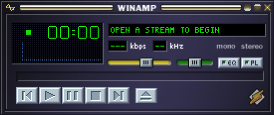
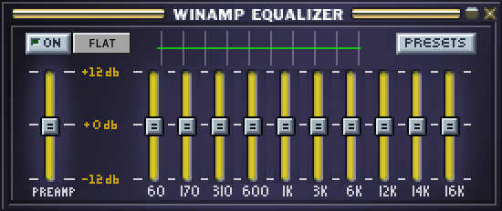
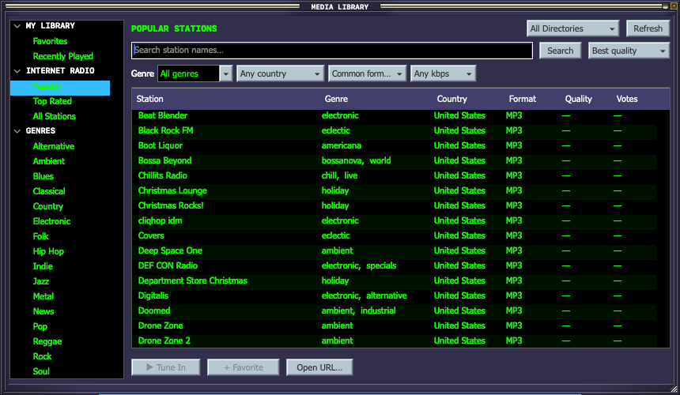
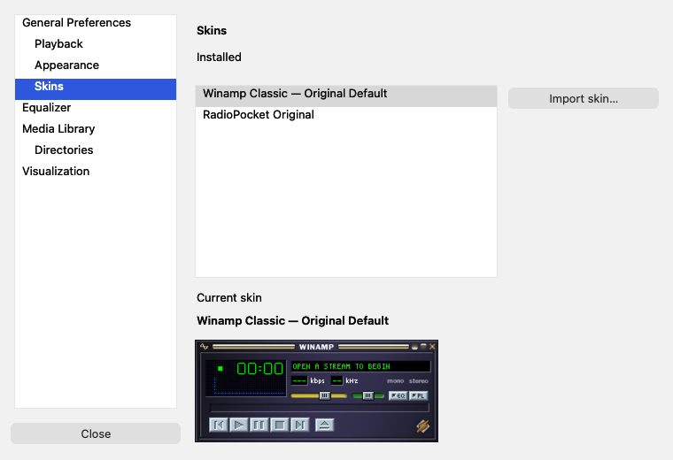
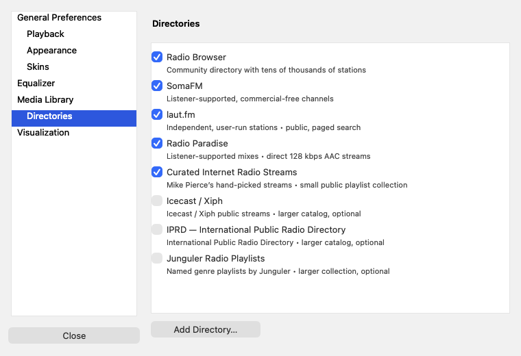

# RadioPocket 0.8

A small, native macOS internet-radio player inspired by classic Winamp. Swift + AppKit + AudioToolbox/AVFoundation, with a small C DSP core. No package dependencies, browser runtime, account, app backend, large bundled station database. Station discovery offers eight built-in sources: Radio Browser, SomaFM, laut.fm, Radio Paradise, Curated Internet Radio Streams, Icecast / Xiph, IPRD, and Junguler Radio Playlists.


## At a glance

- Direct internet radio streams, station discovery, favorites, and recent history.
- Eleven bundled classic skins plus RadioPocket’s own theme.
- Ten-band equalizer, preamp, all 18 classic presets, and EQF import/export.
- Browser handoff through radio playlists and `radiopocket://` links.
- Native macOS app, about 3.2 MB on disk, with no browser runtime or package dependencies.

## Screenshots

**Compact player — original Winamp Classic skin**



**Equalizer — matching skin, ten bands, and preamp**



**Station library — search, genres, filters, and favorites**



**Preferences — installed skins and player preview**



**Directories — eight sources and custom lists**



Screenshots show the current 0.7 player, equalizer, and library. Directory listings change over time.

## Quick start

Requires **macOS 13 or later**. The included local build targets **Apple Silicon**.

```sh
# Build from source with Apple’s command-line developer tools.
./build.sh
open dist/RadioPocket.app
```

If the app has already been built, just open `dist/RadioPocket.app`. Build output is ignored by Git, so a fresh clone needs the build step. Use **LIB / ⌘B** to discover a station, or **⌘O** to enter a stream URL. Use **EQ / ⌘E** for the equalizer and **SK / ⌘K** for skins.

[Playback controls](#run) · [Website links](#opening-radio-links-from-websites) · [Skin support](#classic-skins-implemented-scope) · [Build and tests](#build-and-test)

## Run

Open `dist/RadioPocket.app` in this project folder. This build is for Apple Silicon Macs running macOS 13 or later. It is locally ad-hoc signed, not notarized for public distribution.

- Click **+** (the eject button in imported skins), or press **⌘O**, to enter a direct HTTP/HTTPS audio URL. A broadcaster’s homepage is usually not its audio stream.
- Optionally name the station and select **Save to Favorites**.
- **+ FAV / ⌘D** saves or renames the current station. **⌘L** opens favorites, with Play, Add, Edit, and Remove. Double-click a station to play it.
- Previous/next move through favorites. **Space** toggles playback. **↑ / ↓** adjust volume. Click or drag the volume bar.
- Pause keeps the connection and buffers what the station sends (up to five minutes), so Play continues where you stopped. **← / →** (or **[ / ]**) go back or forward 10 seconds, and **L** (⌘J) jumps to live; the display shows how far behind live you are. Stop clears the elapsed listening timer and disconnects. Closing the player quits and stops audio.
- **⌘1 / ⌘2 / ⌘3** select interface scale. Default is 550 × 232 points (2×). Drag the title strip to move the player. **⌘T** toggles always-on-top.
- **SK / ⌘K** opens Preferences → Skins. **⌘,** opens Preferences with playback, appearance, equalizer, and library pages. **⌘I** imports a classic `.wsz` or ZIP skin. You can also drop a skin file on the player. **Appearance → Use RadioPocket Theme** restores RadioPocket’s own artwork.

## Opening radio links from websites

Move `RadioPocket.app` into Applications and open it once so macOS registers its supported links and playlist types. The app appears under its own name, **RadioPocket**, including when the Winamp skin is selected.

- **Downloaded `.pls`, `.m3u`, `.m3u8` radio playlists:** use Finder’s **Open With → RadioPocket**. To make it your preferred player for a playlist type, use **Get Info → Open with → RadioPocket → Change All**. The app registers as an alternate handler; it does not change existing defaults.
- **Browser helper choices:** when a browser offers an application chooser for a radio playlist, select RadioPocket. Firefox lets you select an application under Settings → General → Files and Applications. Browser behavior also depends on the website’s content type and download headers.
- **Explicit website links:** a site can use `radiopocket://play?url=ENCODED_HTTP_URL&name=ENCODED_NAME`. The browser may ask to open RadioPocket. The app starts the stream after the link is handed over, whether already running or launching fresh.
- **Share a station:** Radio → Copy Open-in-Player Link copies a properly encoded link for the current or last station. The recipient needs RadioPocket installed.

Ordinary HTTP/HTTPS audio links may play in a browser tab. This app cannot insert itself into every website’s player menu. It does not claim the `http`, `https`, or `winamp` schemes. A site offering a “Winamp” button that downloads a PLS/M3U can work through the playlist association; a button using a proprietary Winamp protocol is not supported.

Website example (encode the complete stream URL, including its query string):

```html
<a href="radiopocket://play?url=https%3A%2F%2Fradio.example%2Flive&amp;name=My%20Radio">Open in RadioPocket</a>
```

Local playlists are limited to 256 KB and open the first supported absolute HTTP/HTTPS entry. Local audio paths are rejected. A downloaded HLS manifest needs its original web URL to resolve segments correctly. Opening a link does not add it to Favorites. Multiple files in one open event play the first one.

References: [Apple URL/document handling](https://developer.apple.com/documentation/appkit/nsapplicationdelegate/application(_:open:)) and [Firefox download actions](https://support.mozilla.org/en-US/kb/change-firefox-behavior-when-open-file).

## Station library and discovery

Click **LIB** or press **⌘B** to open the classic-style station library. The compact player remains separate. Browse **Popular**, **Top Rated**, **All Stations**, or the genre tree; **Favorites** and **Recently Played** are local collections.

- Search station names, choose or enter a genre, and filter by country, format, or minimum bitrate.
- Sort using the dropdown or column headings. The station list is one continuous list: the next 100 directory records load automatically as you scroll toward the end, and format filtering can hide some of them.
- Double-click a station, press Return, or click **Tune In**. **+ Favorite** saves it locally without changing the selection. The context menu can copy its stream URL.
- Recent history contains up to 30 unique stations that actually reached playback. Failed connection attempts are not added.
- The default format filter favors MP3/AAC/HLS. **All formats** reveals other entries, including codecs macOS may not support. Directory codec and working-status metadata can be stale.

Open **Preferences → Directories** to choose from eight built-in sources or add your own M3U / PLS list or Radio Browser API server. Radio Browser, SomaFM, laut.fm, Radio Paradise, and Mike Pierce’s Curated Internet Radio Streams start enabled. Icecast / Xiph, IPRD, and Junguler Radio Playlists are available but unchecked initially because they download larger catalogs. Saved on/off choices survive upgrades; new built-ins appear automatically. The directory list scrolls when needed.

[Source documentation and limits](Resources/DIRECTORY-SOURCES.md) lists the public endpoints and attribution. No API key or account is needed for these eight sources. Some catalogs omit country, codec, or bitrate metadata, so those filters can hide their listings. laut.fm filters and sorts within each provider page.

The primary source remains [Radio Browser](https://www.radio-browser.info/), an open community-maintained directory, without an API key. Popularity reflects directory clicks; votes are directory votes, not live listener counts. Station availability varies. Directory errors do not interrupt current audio, and local favorites, history, and direct URLs remain usable.

The library opens from a small on-disk cache of the lists people open first (Popular, Top Rated and A–Z, plus any genre or country view already browsed), so it appears instantly and works offline. Ten seconds after launch, and about every 45 minutes while the app is open, RadioPocket quietly refreshes any of those pages older than six hours: one 100-station request at a time, 1.5 seconds apart, at utility priority, then it frees any downloaded catalog. It pauses for 15 minutes on Low Power Mode, a hot Mac, a hotspot or Low Data Mode, or after two failed requests. A page shown from the cache says when it was saved; a page older than a week is only used if the directory is unreachable. Refresh always goes live. The cache is one small JSON file per page in `~/Library/Caches/RadioPocket/Stations`, capped at 300 files / 16 MB and pruned after a month, read only when a page is opened (nothing is held in memory). Typed searches are never saved. Turn it off, or clear it, in Preferences ▸ Media Library; with it off there is no directory request until the library is opened. Live requests use mirror failover, cancellation of obsolete searches, a six-page in-memory cache lasting five minutes, and a 2 MB response limit for Radio Browser. SomaFM, laut.fm and custom lists also have bounded requests; optional full-catalog feeds have separate documented caps. No artwork downloads or per-station polling. An explicit Tune In from the directory sends its standard station-click request to Radio Browser; browsing alone does not. There is no separate app analytics service.

## Station tools, windows and sleep

- **Jump to Station** (**J** in the player, or **⇧⌘J**): type part of a station name, **↑ / ↓** to choose, **Return** to tune in. It searches your favorites and recently played stations.
- **Station Info** (**I**, or **⇧⌘I**): the live format and sample rate, the bitrate measured from the connection, how much time-shift buffer is kept and how far behind live you are, and the leveler's gain. **Look Up Details** asks Radio Browser for the country, genre and homepage; nothing is sent until you press it.
- **Sleep Timer** (Radio menu): stops playback after 15, 30, 45, 60, 90 or 120 minutes, fading the volume over the last 20 seconds and restoring it afterwards. The countdown shows on the station line.
- **Loudness Leveling** (Radio menu): a slow level follower with a soft limiter that brings quiet stations up (to +10 dB) and loud ones down (to −12 dB) toward one average level. It follows the EQ, applies to every stream RadioPocket decodes itself, and is off by default. Station switches take a few seconds to settle.
- **Window snapping and docking**: the player, equalizer, library and favorites snap to screen edges and to one another. The equalizer opens docked under the player, and dragging the player carries docked windows with it. Hold **Option** while dragging to move freely. Double-click a title bar to window-shade it.

## Visualizer

The player’s 76 × 16 visualizer slot shows a real spectrum analyzer or oscilloscope of the audio being played (post-EQ, before the volume control, so quiet listening still moves the bars). While stopped, paused or on an HLS stream the slot shows the status text instead.

- **Analysis:** the AudioQueue processing tap that already runs the EQ copies the mono-mixed output into a fixed 8192-sample lock-free ring. On the main thread a 2048-point Hann-windowed vDSP FFT is folded into 76 log-spaced bands (45 Hz–16 kHz, +3 dB/octave tilt) with Winamp-style bar falloff and peak hold.
- **Player slot:** click to cycle Bars → Fire → Oscilloscope. Double-click to open the visualization window. Right-click for coloring (Normal / Fire / Line), peaks, falloff, oscilloscope style and refresh rate (60 / 30 / 15 fps). Colors come from the skin’s `VISCOLOR.TXT` when it has one, otherwise Winamp’s stock palette.
- **Visualization window (⇧⌘V):** Spectrum Bars, Oscilloscope, Mirror Spectrum, Circular Spectrum, Spectrogram, Waveform Ring, Vectorscope, Waterfall, Starfield, Spectrum Tunnel, Plasma, Kaleidoscope, Fireworks and Aurora (keys 1–9 and 0 jump to the first ten). ⌃⌘F or the FULL SCREEN button goes full screen.
- **Idle cost:** one timer exists only while a visualizer is actually on screen (window visible, not minimized or covered) and audio is playing or the bars are still falling; it stops itself afterwards. Full screen runs at 60 fps.

Hotkeys in the visualization window and full screen (press **H** or **F1** for the same list on screen):

| Key | Action |
|---|---|
| Double-click · F · ⌥↩ | Toggle full screen (Esc leaves) |
| Space · → · N / Backspace · ← | Next / previous visualization |
| 1 – 5 | Jump to a visualization |
| R | Auto-cycle every 15 seconds |
| K | Cycle coloring |
| P | Peak markers |
| - · = | Slower / faster falloff |
| T | Title overlay in full screen |
| Z X C V B | Previous · Play · Pause · Stop · Next (also in the player) |
| ↑ ↓ | Volume |

Z X C V B follow Winamp’s classic transport keys. The remaining visualizer keys are RadioPocket’s own, loosely modeled on MilkDrop’s conventions.

## Equalizer

Click **EQ** or press **⌘E** to open the separate compact equalizer window, positioned below the player. It follows the player’s scale and imported classic skin.

- Ten bands: **60, 170, 310, 600 Hz; 1, 3, 6, 12, 14, 16 kHz**, with ±12 dB controls and a separate preamp.
- **ON/OFF** enables or bypasses processing. **FLAT** resets all bands and preamp to zero. Selecting a preset enables EQ.
- Drag a slider; double-click or Option-click to reset it. Arrow keys adjust a focused slider in 0.5 dB steps. Hover for the exact gain.
- **PRESETS** contains all 18 stock Winamp preset curves: Classical, Club, Dance, Flat, Laptop speakers/headphones, Large hall, Party, Pop, Reggae, Rock, Soft, Ska, Full Bass, Soft Rock, Full Treble, Full Bass & Treble, Live, and Techno.
- Save named custom presets, import `.eqf`/`.q1` libraries, or export the current preset as `.eqf`. Built-in presets stay intact. Import/export uses Winamp’s quantized gain format.
- The last curve, enabled state, preamp, and custom presets survive relaunch. EQ starts bypassed on a fresh install.

**EQ applies to every stream RadioPocket decodes itself (MP3, AAC, Opus and HLS). Streams that fall back to AVPlayer play without EQ; the player explicitly displays “EQ unavailable for this stream” when EQ is enabled.** The app does not silently pretend that the sliders affect those streams.

Processing uses ten peaking biquad filters with gain smoothing, fixed state, and atomic control parameters. No allocation, disk access, or locks occur inside the DSP render loop. Bands above the stream’s Nyquist frequency are bypassed. Output samples are bounded; lower the preamp for heavily boosted curves to avoid clipping. Preset band values preserve the stock curves with the stock neutral byte mapped to zero; the filter implementation is not a bit-identical recreation of Winamp’s DSP.

## Stream compatibility

One pipeline plays every supported stream: a source (HTTP/ICY or the built-in HLS client) feeds a demuxer (MP3/AAC via AudioFileStream, Ogg Opus, MPEG-TS), the compressed packets go into a five-minute time-shift ring, and an AudioQueue decodes and plays them. The equalizer, the visualizer, pause and rewind therefore work on all of them.

- **MP3 / AAC (ADTS)** over HTTP(S), with ICY title metadata.
- **Ogg Opus** (mono or stereo) over HTTP(S), decoded by the Opus codec that ships with macOS, with titles from the Opus tags. Chained streams are followed.
- **Ogg Vorbis** over HTTP(S), decoded by the bundled [stb_vorbis](ThirdParty/stb/README.md) (MIT / public domain) into 16-bit PCM, with titles from the comment headers; chained streams are followed. Because PCM is larger than compressed audio, the time-shift buffer holds about four minutes instead of five.
- **HLS** (`.m3u8`, or a playlist served under another address): master playlists (the best audio variant at or below 256 kb/s is chosen), live and finished media playlists, MPEG-TS segments carrying AAC or MP3, packed AAC/MP3 segments, AES-128 encryption, and ID3 titles. Live playback starts two segments from the end.
- `.m3u` and `.pls` URLs are resolved to their first supported HTTP stream; relative entries work.

Fallbacks and limits: fragmented-MP4 (CMAF) and SAMPLE-AES HLS, and MP3/AAC streams AudioFileStream rejects, fall back to macOS AVPlayer, which has no EQ, visualizer or time shift (the display says so). Other Ogg codecs (including Ogg FLAC) are reported as unsupported. FLAC, authentication flows, DRM and arbitrary webpage URLs are not supported. There is no local music library, recording or MilkDrop in this release.

### Staying connected

- A dropped connection reconnects with backoff (2, 4, 8, 16, then 30 seconds), up to eight tries; the display shows `RETRY n/8`. Playing for 30 seconds resets the count.
- A stream that stays open but delivers nothing for 20 seconds is restarted.
- While the network is down playback waits instead of burning retries. When the network returns, or switches interface (Wi-Fi to Ethernet), or the Mac wakes from sleep, playback reconnects. A station that gave up is retried automatically when the network comes back.
- If a station still can’t be reached, RadioPocket asks the Radio Browser directory whether a station saved from it has a new address and tries that (updating the favorite if it plays). Otherwise it offers the closest similarly named stream, Find Similar, or the next favorite.
- A paused stream whose server dropped the connection says so, and Play reconnects to live.

## Included skins

**Winamp Classic — Original Default** is selected on a fresh install. Existing imported skins are preserved. Choose **SK**, **⌘K**, or **Appearance → Choose Skin…** to switch immediately; the choice survives relaunch and applies to both player and equalizer. The Preferences window shows the installed list, current skin name, and a player preview. Imported skins remain installed for reuse. No download is required.

The 11 classic skins are Winamp Classic 2.91, Amiga PPC Dark, Internet Archive, Mac OS X Aqua, My Funny Valentine, Sonic Attitude, TopazAmp, Vizor, XMMS Turquoise, Zaxon Remake, and Rei. RadioPocket Original is a twelfth appearance. These are distinct designs, not recolors. Only the selected skin is decoded; archive storage totals about 1.8 MB.

## Classic skins: implemented scope

The renderer uses the classic 275 × 116 main-player layout and reads:

- `MAIN.BMP`: background
- `TITLEBAR.BMP`: title strip and window control sprites
- `CBUTTONS.BMP`: normal/pressed transport and eject buttons
- `TEXT.BMP`: bitmap text for supported characters; native text fallback for other characters
- `NUMBERS.BMP` / `NUMS_EX.BMP`: elapsed-time digits
- `VOLUME.BMP`: volume track and thumb
- `EQMAIN.BMP`: equalizer background, title, controls, slider tracks/thumbs, and graph background
- `SHUFREP.BMP`: EQ toggle button
- `GEN.BMP`: secondary-window border artwork

Filenames are case-insensitive and may live in a nested archive directory. Missing optional bitmaps fall back to built-in drawing. The library, favorites, and stream-entry panel use the selected skin’s generic-window border artwork when present, with a shared classic palette and native AppKit content. This does not implement every skin’s custom library controls or colors. Radio-specific buttons retain RadioPocket styling. This is **partial classic skin compatibility**, not a pixel-for-pixel implementation of every Winamp window. Modern `.wal` skins, scripts, playlist skins, custom cursors, transparency/region masks, and Windows plug-ins are not implemented.

Only recognized bitmap entries are read; archive paths are never extracted to disk. Archive, decoded image dimensions, and per-entry data have limits. Imported bitmap assets are saved locally; the original skin file can then be moved. Eleven unchanged third-party classic skin archives are bundled, including the original Winamp 2.91 default. See [skin credits and provenance](Resources/SKIN-CREDITS.md); embedded author notices remain in each archive. Skins imported in v0.1 need to be reimported to add their EQ artwork, because v0.1 retained only the main-player bitmaps.

## Data and resource use

Favorites, the last 30 successfully played stations, last station, volume, scale, and EQ settings live in `~/Library/Application Support/RadioPocket/library.json`. The imported skin is in `skin.json` beside it. Writes are atomic. Invalid saved libraries are reported without overwriting them. Stream URLs are stored as entered, so any token embedded in a URL is also stored locally. Playback does not start automatically at launch.

The release app is about 3.2 MB on disk, excluding OS-provided frameworks and user-imported skins. The audio queue uses eight fixed 16 KB buffers fed from the time-shift ring, which holds at most five minutes (24 MB) of compressed audio. The DSP state is fixed-size. Station lists downloaded for browsing are held in memory only briefly: they are released two and a half minutes after the last directory search, after RadioPocket has been hidden or behind other apps for 90 seconds, and at once when macOS reports memory pressure, and malloc is then asked to return the freed pages to the system (the saved lists on disk are untouched, and none of this polls). There is no continuous animation or idle polling loop, and the elapsed timer runs only during playback. Fallback AVPlayer buffering is managed by macOS. Disk size does not imply a megabyte-scale runtime footprint; system audio/network/UI frameworks consume additional memory.

## Build and test

Requires macOS and the Apple command-line developer tools. No full Xcode installation or downloaded Swift packages are needed.

```sh
./test.sh
./test-network.sh  # Python 3; isolated loopback fixtures
./test-streams.sh  # real app against local Opus, HLS, ICY, reconnect and time-shift fixtures (needs audio output)
./build.sh
open dist/RadioPocket.app
```

The build script compiles in release mode, creates `dist/RadioPocket.app`, and ad-hoc signs it for local use. Set `RADIOPOCKET_APP_PATH` to build into a separate app path while another copy is running. Build on an Intel Mac to produce an Intel binary; this artifact is not universal.

`test.sh` creates temporary fixtures and checks URL validation, M3U/PLS/HLS parsing, persistent favorites, duplicate prevention, corruption preservation, classic ZIP import, bitmap decoding, sprite bounds, all 18 EQF preset round trips, persisted EQ settings, frequency gain, bypass, stereo consistency, and low-rate stability. To include an existing classic skin:

```sh
RADIOPOCKET_TEST_SKIN=/absolute/path/to/skin.wsz ./test.sh
```

`test-streams.sh` serves a 440 Hz tone as ICY AAC, Ogg Opus (muxed from afconvert’s Opus packets), live HLS in MPEG-TS, packed AAC, AES-128 and master-playlist forms, plus chained Ogg Vorbis (when `ffmpeg` is installed to encode it) and streams that drop or go silent. It launches the muted app for each and passes only when decoded audio reached the analyzer or EQ, pause/rewind/live behaved, or the engine reconnected by itself.

`test-network.sh` checks mirror failover, caching, paging, errors, oversized responses, cancellation, cache eviction, and explicit-only play reporting against a local fixture server. It does not contact public stations.

Developer smoke-test options (use a temporary data directory):

```sh
dist/RadioPocket.app/Contents/MacOS/RadioPocket \
  --data-dir /tmp/radiopocket-smoke \
  --smoke-stream http://127.0.0.1:18764/live \
  --smoke-result /tmp/radiopocket-result.txt
```

Smoke playback is muted and exits after reaching the playing state. Add `--test-eq` to apply a -12 dB preamp and require measured processed samples with the expected attenuation; this mode uses a near-silent output volume. `--test-vis` passes only when the loudest FFT band of the live capture matches a 440 Hz test tone. `--preview /absolute/path.png` exports the rendered player, `--eq-preview /absolute/eq.png` additionally exports the EQ window, and `--skin /absolute/path.wsz` applies a skin temporarily for that preview.

`--directory-preview /absolute/library.png` renders the loaded station library and exits. For isolated directory tests, combine `--data-dir` with `--directory-api http://127.0.0.1:PORT`; only loopback overrides are accepted.

## Validation performed

- Release compilation and local signature verification.
- macOS Launch Services handoff: explicit app links on cold launch and while running, plus a downloaded PLS file, all reaching muted live playback.
- Bundle checks for the custom URL scheme and alternate M3U/PLS handlers.
- 110 regression checks with a real classic skin, including a generated nested uppercase-filename skin, gain measurements at all ten frequencies, stereo smoothing, and EQF round trips for every stock preset.
- 24 directory network checks against an isolated HTTP server, including saved-list reads after a restart, quiet refresh of stale pages, offline fallback, and paced warming.
- Live Radio Browser responses decoded and the populated library inspected visually.
- Library UI checks: search, scrolling to load more stations, saving while preserving selection, playback, recent history, and directory failure while audio continues.
- Local continuous HTTP MP3/AAC playback, including measured -12 dB attenuation through the live DSP path.
- ICY metadata playback with title extraction and working EQ.
- HLS fallback playback with an explicit EQ-unavailable status.
- Existing M3U/PLS resolution remains covered by parser checks.
- Actual UI stream entry, playback, saving/listing a favorite, opening EQ, and selecting Flat and Full Bass with verified slider values.
- Rendered player, equalizer, library, favorites, and stream-entry panel inspected visually.
- Runtime layout audit: controls remain within bounds and do not overlap at 1×, 2×, and 3×; player/EQ collapse and restore.
- Muted MP3 playback through the updated app with measured -12 dB EQ attenuation.
- Live 0.6 UI checks completed October 29, 2026 in an isolated app/data directory: player and EQ collapse/restore, keyboard mute, URL validation, Escape/cancel, play/pause/resume, saving favorites and selection actions, Rock/Flat presets, live directory search and format filtering, pagination, favorite saving during uninterrupted audio, and switching to Aqua.

Public station compatibility, Intel hardware, and older supported macOS versions still need broader testing before distribution.

## Text alignment in 0.7

The main display now follows the original 275 × 116 coordinate grid: the six-pixel title text starts at (111, 27), clock digits at x=48/60/78/90 and y=26, and the original kbps/kHz label areas stay intact. Station names occupy the former seek-bar area instead of covering the audio-info labels. Missing audio metrics are displayed as dashes, not guessed values. The volume readout stays inside the former balance-control rectangle.

Bitmap text is clipped to whole five-pixel character cells, with an ellipsis for overflow. Native Unicode fallback gets a full line-height box. Display text/background colors come from the selected skin; library headers and custom button labels use vertically centered, integer-aligned baselines. The app does not add a continuously scrolling marquee.

Coordinate references: [Webamp’s main-window layout](https://github.com/captbaritone/webamp/blob/master/packages/webamp/css/main-window.css) and [sprite/font definitions](https://github.com/captbaritone/webamp/blob/master/packages/webamp/js/skinSprites.ts). Webamp is a reconstruction used here as a layout reference, not the original Winamp source code.

## UI refinements in 0.6

The player’s title buttons and transport sprites now retain their original dimensions. Custom buttons have centered labels, full bevels, and consistent sizing. Volume clicks track the thumb’s actual travel. Both player and equalizer title-bar collapse buttons work; click again to restore.

The EQ uses the skin’s original slider backgrounds and shows a compact band-gain curve. The library, favorites, and stream-entry window share classic square controls, compact typography, dark lists, and `GEN.BMP` border artwork when available. System file pickers, error alerts, and preset naming prompts remain native macOS dialogs. Imported skins without generic-window artwork use a classic fallback border. Previously imported nonbundled skins should be reimported to retain their generic-window artwork; bundled skins refresh their artwork automatically.

The library uses an 860 × 500 point default window and supports resizing down to 800 × 430. Empty favorites disable selection-dependent actions. Stream entry displays URL validation errors inside the dialog.

## Design references

Classic skin format behavior was checked against [Webamp’s skin documentation](https://docs.webamp.org/docs/features/skins/) and its publicly documented sprite layouts. Playback uses [Apple AVFoundation](https://developer.apple.com/documentation/avfoundation). RadioPocket is an independent prototype and is not affiliated with Winamp.

Stock preset numeric data was checked against [the exported Winamp.q1 preset collection](https://github.com/schollz/Winamp-Original-Presets). Only numeric curve values are included; no original preset binaries are bundled. EQF structure was checked against [Webamp’s EQF format parser](https://github.com/captbaritone/webamp/tree/master/packages/winamp-eqf).

Directory integration follows the [Radio Browser API documentation](https://docs.radio-browser.info/).

UI development checks: combine `--preview /absolute/player.png` with `--eq-preview /absolute/eq.png`, `--panels-preview /existing/output/directory`, and `--ui-audit /absolute/result.txt`. Always supply an isolated `--data-dir`.
